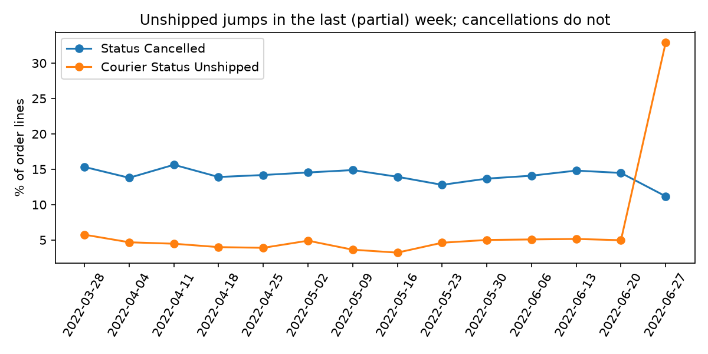
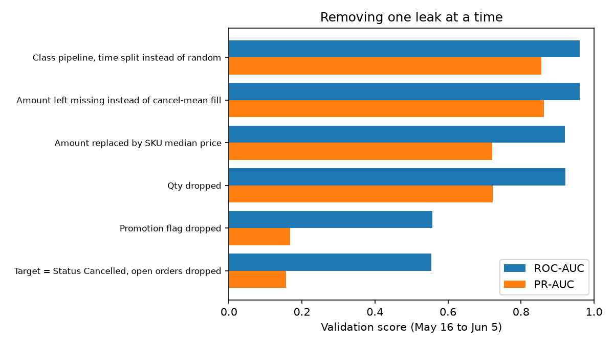
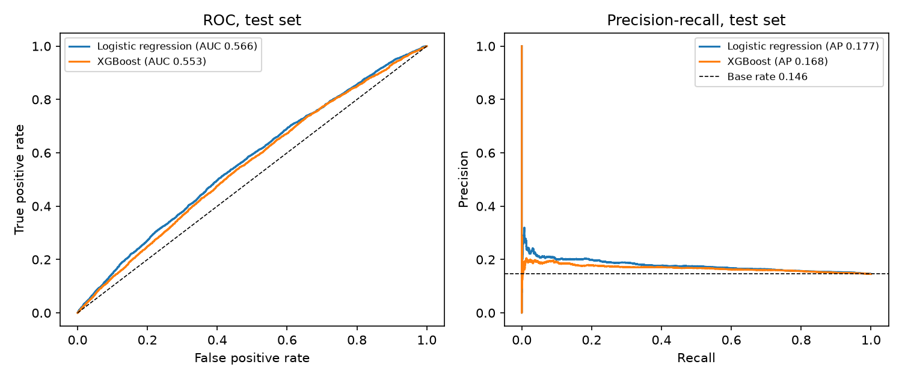
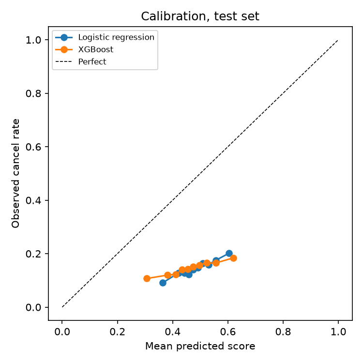
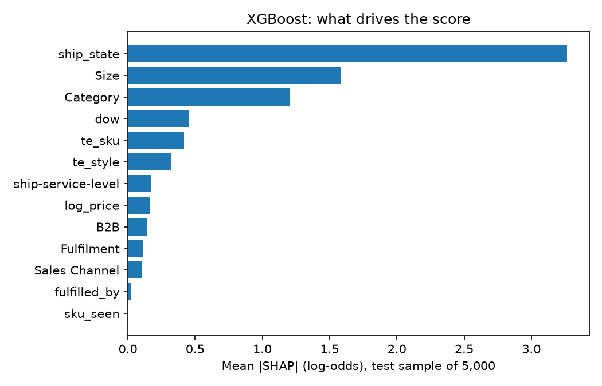

# Predicting order cancellations at order time: a leak-free redo

This project redoes an XGBoost model I built for a 4-person class project (ITEC-621 Predictive Analytics, American University, spring 2026). In the class project the model was mine and the data cleaning was shared by the group. This version is my own work only.

The class model reported a test AUC of 0.946 and sensitivity of 0.839. Most of that came from fields that encode the outcome. After removing them and using a time split, the model scores a test ROC-AUC of 0.553 and PR-AUC of 0.168 against a base rate of 0.146. The fields that are known when an order is placed carry very little signal about whether it will be cancelled.

The plan, target, split, and cost assumption were written in [PLAN.md](PLAN.md) and committed before any model was fit.

## Data

- Source: [E-Commerce Sales Dataset](https://www.kaggle.com/datasets/thedevastator/unlock-profits-with-e-commerce-sales-data) on Kaggle (The Devastator), which credits data.world user [anilsharma87](https://data.world/anilsharma87). File used: `Amazon Sale Report.csv`.
- 128,975 order lines from one apparel seller on Amazon India, Mar 31 to Jun 29, 2022. 120,378 distinct orders.
- The Kaggle license field says "Other (specified in description)" and the description names no license. The CSV is not included here. Download it from Kaggle.

## Target

`y = 1` when `Status == "Cancelled"` (18,332 lines). The class version also counted Courier Status "Cancelled" or "Unshipped" (19,477 lines). I did not count "Unshipped":

- Of 6,681 Unshipped lines, 5,631 already have Status Cancelled, 927 are Pending, and 123 have another status.
- Unshipped is 3 to 6% of lines in most weeks and 33% in the last partial week. That fits "not shipped yet when the data was pulled".

I dropped 947 lines whose outcome was still open (Pending, Pending - Waiting for Pick Up, Shipping). 887 of them fall in the last week. After that, 128,028 lines remain with a 14.3% cancel rate.



## Split

By order date. All lines of an order share one date, so no order is split across sets.

| Set | Dates (2022) | Lines | Cancel rate |
|---|---|---|---|
| Train | Mar 31 to May 15 | 71,499 | 14.5% |
| Validation | May 16 to Jun 5 | 26,955 | 13.5% |
| Test | Jun 6 to Jun 29 | 29,574 | 14.6% |

Early stopping, model choice, and thresholds use validation only. The test set was scored once.

## What was wrong in the class version, and what changed

| # | Problem | Fix |
|---|---|---|
| 1 | Missing or zero Amount was filled with the mean Amount of cancelled orders (645.754204). 10,136 lines carry that value; 77.0% of them are cancelled and they hold 40.1% of all cancellations. | The row's own Amount is not used. A price proxy (median unit price of the SKU in training data) replaces it. |
| 2 | Qty is 0 on 69.3% of cancelled lines and 0.1% of others. The class cleaning changed 0 to 1. | Qty is not used. |
| 3 | Status and Courier Status are recorded after the outcome. | Never used as features. |
| 4 | Random 70/30 split. | Time split, dates above. |
| 5 | Early stopping watched the test set. | Early stopping on validation only. |
| 6 | Fixed 0.5 threshold. | Threshold chosen on validation from a stated cost assumption. |
| 7 | Found in this redo: promotion-ids is missing on 98.4% of cancelled lines and 28.2% of others. For Merchant orders it is 100.0% vs 0.1%. Promotions appear to be written at invoicing, not at order time. The class model named this flag its top predictor. | Promotion features are not used. |

## Leak audit

Share of lines with each property, cancelled vs not cancelled (open orders dropped). From `outputs/leak_audit.csv`.

| Check | Cancelled % | Not cancelled % | Decision |
|---|---|---|---|
| Qty is 0 | 69.3 | 0.1 | Leak. Drop Qty. |
| Amount missing | 41.3 | 0.2 | Leak. Do not use the row's own Amount. |
| currency missing | 41.3 | 0.2 | Leak. Same rows as missing Amount. |
| promotion-ids missing | 98.4 | 28.2 | Leak. Drop promotion features. |
| promotion-ids missing, Merchant orders | 100.0 | 0.1 | Leak. |
| promotion-ids missing, Amazon orders | 97.4 | 39.7 | Leak. |
| Courier Status Unshipped | 30.7 | 0.1 | Recorded after the outcome. |
| Courier Status missing | 37.4 | 0.0 | Recorded after the outcome. |
| Fulfilment is Merchant | 37.4 | 29.1 | Known at order time. Keep. |
| B2B | 0.4 | 0.7 | Known at order time. Keep. |

When Amount is present, the median is 601.9 for cancelled lines and 625.0 for others, so price itself is not a strong signal. Its missingness is.

## How much each leak inflated the score

I first reran the class pipeline from the raw file in Python (same target, cleaning, features, parameters, random 70/30 split, early stopping on the test set, 0.5 cutoff). It reproduces the class result: ROC-AUC 0.948 and sensitivity 0.836, against the reported 0.946 and 0.839.

Then I moved it to the time split and removed one leak at a time. These rows are scored on validation, not test.

| Step | Val ROC-AUC | Val PR-AUC | Sensitivity at 0.5 |
|---|---|---|---|
| 1. Class pipeline, time split | 0.961 | 0.855 | 0.883 |
| 2. Amount left missing instead of filled | 0.961 | 0.863 | 0.889 |
| 3. Amount replaced by SKU median price | 0.920 | 0.721 | 0.957 |
| 4. Qty dropped | 0.921 | 0.722 | 0.951 |
| 5. Promotion flag dropped | 0.557 | 0.168 | 0.441 |
| 6. Target = Status Cancelled, open orders dropped | 0.555 | 0.157 | 0.435 |



The Amount fill and the raw missing Amount carry the same signal, so step 2 changes nothing. Removing Amount missingness costs about 0.04 AUC. Qty adds nothing once Amount missingness is gone, because both mark the same rows. The promotion field carries almost all of the rest.

## Final models

Features, all known at order time: day of week, Fulfilment, Sales Channel, ship-service-level, Category, Size, ship-state (states with under 100 training lines grouped), B2B, fulfilled-by, SKU and Style target encodings (out-of-fold on training data, grouped by order), SKU median price, and a flag for SKUs not seen in training.

- Logistic regression with balanced class weights. C picked on validation PR-AUC (C = 1.0).
- XGBoost with `scale_pos_weight` = 5.88. Early stopping on validation log loss. Six settings tried; best on validation PR-AUC was max_depth 3, min_child_weight 10, 909 trees.

### Test results (scored once)

| Model | ROC-AUC | PR-AUC | Base rate |
|---|---|---|---|
| Logistic regression | 0.566 | 0.177 | 0.146 |
| XGBoost | 0.553 | 0.168 | 0.146 |

XGBoost does not beat the logistic regression. There is little nonlinear structure for it to find.



### Threshold and cost assumption

Assumption, not a measured cost: a missed cancellation costs 3 times a false alarm. Under that assumption, flagging an order is only worth it when its cancel probability is above 1 / (1 + 3) = 25%. On validation, no cutoff for either model had a lower total cost than flagging nothing, so the chosen action at 3x is to flag nothing. Sensitivity at that cutoff is 0.

Other ratios, with cutoffs chosen on validation and applied once to test (XGBoost):

| Cost ratio | Cutoff | Test sensitivity | Test precision | Lines flagged |
|---|---|---|---|---|
| 2x | flag none | 0.000 | n/a | 0.0% |
| 3x (assumed) | flag none | 0.000 | n/a | 0.0% |
| 5x | 0.581 | 0.118 | 0.186 | 9.3% |
| 10x | 0.266 | 0.987 | 0.147 | 98.1% |

Logistic regression at 5x: sensitivity 0.126, precision 0.202, 9.1% flagged. The 10x row flags almost everything, which is the same as no model.

### Calibration

The class weights push scores up, so raw scores are not probabilities. The observed cancel rate stays in a narrow band across score deciles, which matches the low AUC.



### What drives the XGBoost score

Mean absolute SHAP value on a 5,000-line test sample, summed over the one-hot columns of each feature. Features with many levels (ship-state, Size) collect more total SHAP from many small effects, so this ranking overstates them.



## Old vs new

| Metric | Class report | Class pipeline rerun | New, test set | Why |
|---|---|---|---|---|
| ROC-AUC | 0.946 | 0.948 | 0.553 | Amount, Qty, and promotion leaks removed; time split |
| PR-AUC | not reported | 0.858 | 0.168 | |
| Sensitivity | 0.839 | 0.836 | 0.000 | Class used a 0.5 cutoff; new cutoff from the 3x cost assumption flags nothing |
| Sensitivity, 5x cutoff | not reported | n/a | 0.118 | Secondary cost assumption |
| Precision, 5x cutoff | not reported | n/a | 0.186 | Secondary cost assumption |
| Positive rate | 0.151 | 0.151 | 0.146 | Status Cancelled only, open orders dropped |

The new numbers are much lower. The class numbers should not be read as a validated result.

## Business read

Cancel rates in the training period (`business_read_train` in `outputs/metrics.json`):

- Merchant-fulfilled (Easy Ship) lines cancel at 17.8% vs 13.0% for Amazon-fulfilled. Every Merchant line is Standard shipping, so fulfilment route and service level cannot be separated in this data.
- Amazon-fulfilled Standard shipping lines cancel at 5.1%, but there are only 609 of them.
- B2B lines cancel at 7.7% vs 14.6% for others (497 B2B lines).
- Category spread is small: 11.8% for Top to 15.1% for kurta.

The fulfilment route is the one lever the seller controls that lines up with a clear gap. Whether moving SKUs to Amazon fulfilment would lower cancellations cannot be tested with this data; the gap may come from which products or buyers each route serves. Promotions cannot be judged here because the field is filled in after the outcome.

At order time, this data does not support a per-order cancellation flag. Better inputs would be things like payment method (cash on delivery), buyer history, or delivery promise date, none of which are in this file.

## Limitations

- One seller, 13 weeks, one market.
- The last test days may still undercount cancellations for orders that were open at pull time.
- For max_depth 5 and 7, validation log loss kept improving to the 2,000-round cap, so early stopping never triggered for those settings. Their validation PR-AUC was lower than depth 3 either way.
- The cost ratio is an assumption.

## Process notes

- The 10x cost ratio was added after seeing validation results and before the test run. PLAN.md listed 2x and 5x as sensitivity checks.
- The first full run scored the test set, then crashed while writing the comparison table (a string formatting bug on "flag none"). I fixed that line and reran. The test numbers in both runs are identical; both logs are in `outputs/`.
- `--dev` runs the whole pipeline but stops before the test set. All debugging used it.

## Reproduce

```bash
python3.12 -m venv .venv
.venv/bin/pip install -r requirements.txt
.venv/bin/python cancellation_model.py "path/to/Amazon Sale Report.csv"
```

Runs in about a minute on a laptop. Writes `outputs/metrics.json`, the tables in `outputs/`, and the charts in `charts/`. Seed 28 throughout.

## Files

- `PLAN.md`: plan, committed before modeling
- `cancellation_model.py`: the whole pipeline
- `outputs/metrics.json`: every number in this README
- `outputs/leak_audit.csv`, `outputs/leak_ladder_validation.csv`, `outputs/old_vs_new.csv`, `outputs/weekly_status.csv`
- `charts/`: PNG charts
